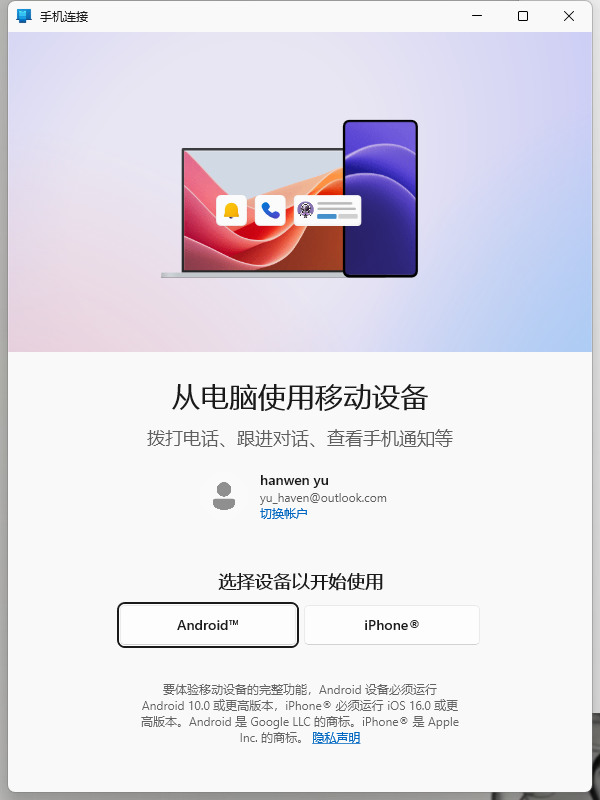
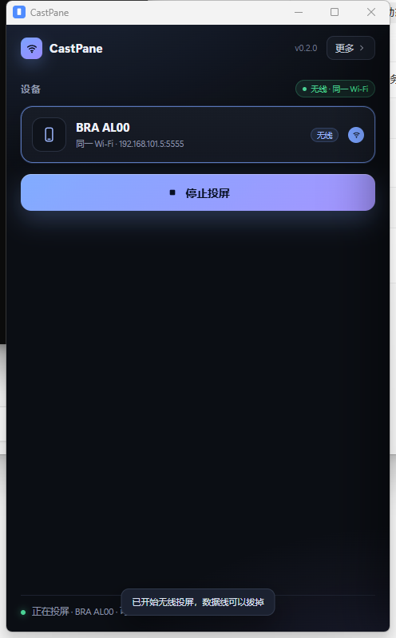

# 竞品拆解：电脑 ↔ 手机文件互传的信息层级

- 日期：2026-11-16
- 目的：决定 CastPane v0.3.0 文件互传的入口、目录浏览、发送/接收与进度呈现。
- 约束：复用现有无线 ADB，不额外安装手机 App；不把文件管理器堆回首屏。
- 用户不在场且已授权自行选定方案；需要拍板的取舍写在交付说明。

## 1. 拆解表

| 软件 | 截图 / 来源 | 控件位置 / 层级 | 交互 | 对我们的结论 |
|---|---|---|---|---|
| **LocalSend（开源，AirDrop 替代）** | [LocalSend 官网](https://localsend.cc/)（官方截图；未安装） | 首屏是「附近设备」列表；选设备 → 选文件/文件夹 → 发送；接收端弹出确认；传输页显示进度、速度、完成 | 先选设备再选文件；不做对端目录浏览；传输记录在单独 tab | 我们学「设备/文件/传输」三段式，但用 ADB 目录浏览替代「先选设备」；传输卡片常驻页面底部 |
| **华为分享 / 多屏协同** | [华为官方：手机与平板协同](https://consumer.huawei.com/cn/support/content/zh-cn15824197/)（官方步骤页） | 手机/平板/电脑协同后，文件可在设备间拖拽；传输进度在系统通知/悬浮窗；没有对端完整文件管理器 | 拖拽即传；一次一个文件或一批；失败在通知里说原因 | 我们学「拖拽/一次动作」的短路径；但 Windows 端需要能选目标目录，所以保留面包屑 + 当前目录发送 |
| **AirDroid（网页/桌面端文件管理）** | 产品页（未安装，按官方功能描述） | 设备连接后左侧功能栏有「文件」；进入后是手机目录树/列表，顶部上传/下载；底部或侧栏传输任务 | 浏览目录 → 勾选 → 下载/上传；传输任务有进度与历史 | 我们学「面包屑 + 列表 + 常驻传输卡片」；不学它的账号/远程/通知堆叠 |
| **Windows 文件资源管理器** | 本机标准文件列表（见 `docs/assets/evidence` 中 CastPane 截图） | 顶部地址栏/面包屑；工具栏（新建/排序/查看）；主体是名称/修改日期/类型/大小列；选择后底部状态栏 | 单击选中、双击进入；右键菜单；拖拽 | 我们学「面包屑 + 名称/大小/日期」的信息密度；但手机目录用大触控行、少列，适配 480px 窗口 |
| **Windows 手机连接（Phone Link）文件** | （本机实拍，0.2.0 竞品拆解复用） | 设备连接后功能入口在侧栏；文件功能是独立页面；顶部设备状态，内容区列表 | 先连接设备，再进文件；失败提示在页面内 | 我们学「先连接、再进二级页」；文件入口只在手机 `ready` 时出现，不假装可用 |
| **CastPane 0.2（改造前）** |  | 首屏只有设备和投屏按钮；没有任何文件入口；大块留白 | 用户无法传文件 | **本轮新增一个紧凑 `文件` 入口**，不新增首屏第二排；把空间留给二级页 |

## 2. 对照结论（决定 v0.3.0 的设计）

1. **入口短**：已连接手机时，状态行右侧出现一个 `文件` 小按钮；点一次进二级页。首屏设备行仍是单选，不塞第二个行内按钮。
2. **不堆回首页**：文件页是独立二级页，含返回 + 面包屑 + 工具栏 + 列表 + 传输卡片；首屏可交互元素仍 ≤ 5。
3. **先浏览再接收**：默认 `/sdcard`，文件夹优先；点文件夹进入，点文件选中；底部 `下载到电脑` 才可点。避免「先弹保存框再猜文件」。
4. **发送两条路**：`发送到手机` 打开 Windows 原生文件选择框；也支持把文件/文件夹直接拖进窗口。目标为当前手机目录，默认 `/sdcard/Download/CastPane`。
5. **进度必须真实**：显示文件名、已传/总字节、百分比、速度、耗时；大文件不能只有转圈。失败保留已传部分并给路径。
6. **落盘路径明示**：电脑接收默认 `%USERPROFILE%\Downloads\CastPane`，完成后可 `打开文件夹`；同名文件自动加 `(1)`，不静默覆盖。
7. **权限说人话**：`/sdcard/Android/data` 等受限目录给「系统限制此目录，请换到 Download 或 DCIM」，不显示 adb 原始报错当唯一信息。
8. **视觉**：深色底、卡片分组、蓝色/紫色渐变进度；文件行 44–52px 高；图标区分文件夹/图片/视频/文档/其他；空态一句话。

## 3. 线框图

见 `docs/assets/v03-wireframe.png`（源 `docs/design/v03-wireframe.html`），右图为文件互传页：

- 顶部：返回、标题「文件互传」、设备名/无线状态。
- 路径：`手机 / sdcard / Download` 面包屑 + 刷新。
- 工具栏：`发送到手机`（主）、`下载到电脑`（选中后可用）。
- 列表：文件夹/图片/视频/文档行，名称 + 大小 + 日期。
- 底部：当前传输卡片（文件名、进度条、速度、完成路径/失败原因），最近记录。

## 4. 参考来源

- LocalSend 官网：<https://localsend.cc/>
- 华为官方「手机与平板协同」：<https://consumer.huawei.com/cn/support/content/zh-cn15824197/>
- Android `adb` 文档（push/pull/shell）：<https://developer.android.com/tools/adb>
- 本机实拍：Windows 文件资源管理器、Windows 手机连接、CastPane 0.2 首屏。
