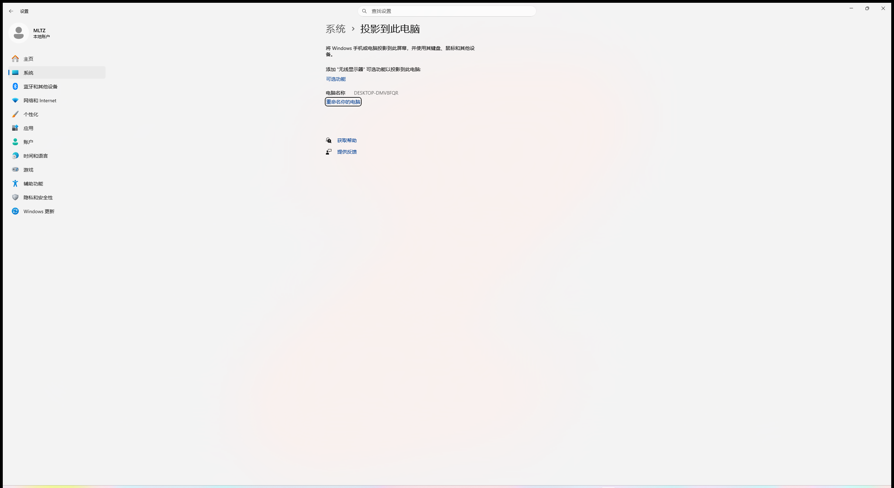
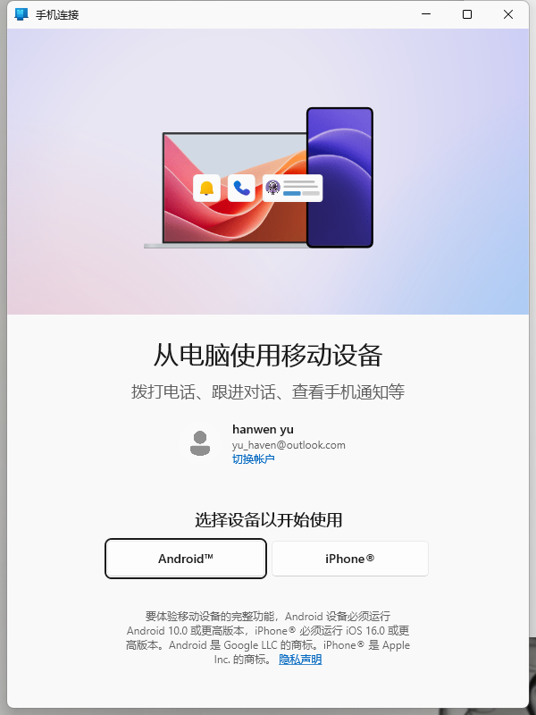
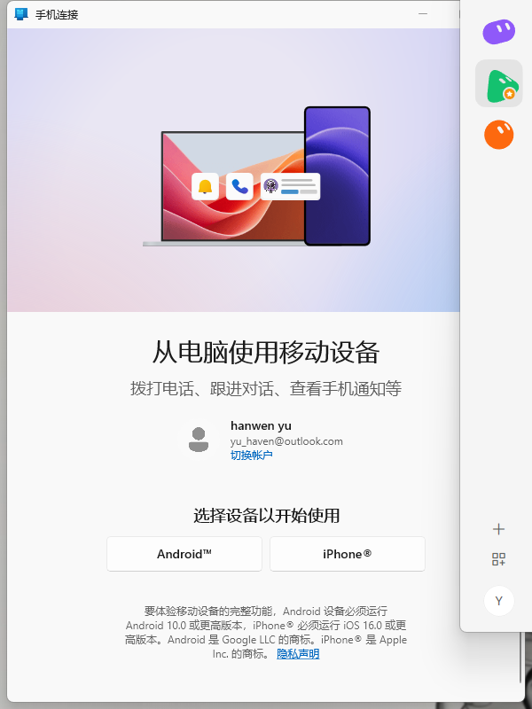
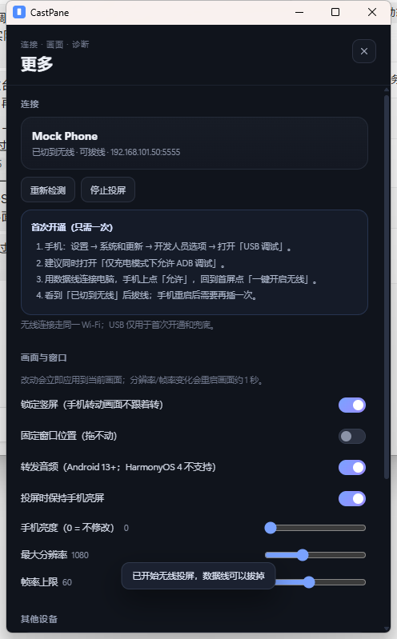

# 竞品拆解：AirPlay 接收端的信息层级（iPad / iPhone 屏幕镜像）

- 日期：2026-11-16
- 目的：决定 CastPane v0.3.0 里 AirPlay 接收端放在哪、启动后给用户看什么。
- 现场事实：本轮网络中没有 iPad/iPhone（见需求卡的 ping + ARP + mDNS 记录）。以下为系统/竞品信息层级拆解，实际 iPad 画面验收待真机。
- 用户不在场且已授权自行选定方案；需要拍板的取舍写在交付说明。

## 1. 拆解表

| 软件 | 截图 / 来源 | 控件位置 / 层级 | 交互 | 对我们的结论 |
|---|---|---|---|---|
| **macOS「AirPlay 接收器」** | [Apple 支持：在 Mac 上使用 AirPlay](https://support.apple.com/zh-tw/guide/mac-mini/apdf1417128d/2023/mac/13)（官方步骤页；本机无 Mac 可实拍） | 系统设置 → 通用 → 隔空投送与接力 → 「AirPlay 接收器」一个开关；旁边只有接收端名称。没有「启动/停止画面」按钮 | 打开开关后，iPhone/iPad 控制中心 → 屏幕镜像 → 选 Mac 名称；连接后 Mac 才出现画面窗口。接收端始终在后台待命 | **接收端状态与「去 iPad 上操作」要分开**：电脑端只负责「已启动/等待/已连接」；步骤用一句话放在状态下面，不堆设置 |
| **AirServer / Reflector（商业接收端）** | 产品主界面（未安装，按官方页面描述）：顶部接收端名称与状态，中间一个大「Start」/已连接设备卡片，设置收在齿轮/标签页 | 首屏就是一个大状态 + 一个主动作；连接后显示设备名和画面窗口；设置不占主界面 | 打开即待命；设备从控制中心选它；断开后回到待命 | 我们学「大状态 + 一个主动作」；不学它的付费/多协议堆叠。**首屏直接给 AirPlay 行**，不要让用户去「更多」找 |
| **Windows「投影到此电脑」** | （本机实拍 Windows 11） | 设置 → 系统 → 投影到此电脑；页面主体只有一段说明、电脑名称、可选功能入口；接收开关不在首屏 | 需要先安装「无线显示器」可选功能，再进设置开启；入口深、步骤多 | **反例**：系统级接收端藏在设置里，用户找不到。CastPane 要把 AirPlay 放在首屏设备区，并给出「控制中心 → 屏幕镜像」的明确路径 |
| **Windows 手机连接（Phone Link）** |  / （本机实拍，0.2.0 竞品拆解复用） | 大插画 → 标题 → 一句价值说明 → 账号/设备选择 → 大按钮；不出现协议参数 | 一次只问一个问题；首屏主动作在视觉中心偏下 | 我们的二级页保留「大插画 + 一句话 + 一个主动作」；不把 Bonjour/端口/渲染器放在首屏 |
| **Android 系统「无线显示」** | （本机实拍，0.2.0 竞品拆解复用） | 顶部返回 + 标题；内容只有一个设备列表；空态一句话；无设置 | 打开即扫描；点设备即连接 | **等待态要像「附近没有设备」一样诚实**：没连接就写「等待 iPad」，不写「正在投屏」 |
| **CastPane 0.2（改造前）** |  | AirPlay 收在「更多 → 其他设备 → details」里；默认折叠；只有「启动接收端」按钮；启动后 toast 一句话，没有步骤/状态页 | 用户要先点「更多」，再展开「其他设备」，再点启动；很容易以为没有 AirPlay | **本轮要删掉这个层级**：AirPlay 升为首屏设备行；「更多」只留接收端名称/渲染器/全屏等设置 |

## 2. 对照结论（决定 v0.3.0 的设计）

1. **首屏直接出现 AirPlay 行**，标题写 `iPad / iPhone 投屏`，副标题写 `控制中心 → 屏幕镜像`，不写协议名让用户猜。
2. **一个主动作**：选中 AirPlay 行后主按钮为 `启动接收端`；启动后同一位置变 `停止接收端`。不在首屏加第二个 AirPlay 按钮。
3. **启动后进入二级页**，而不是只弹 toast：大标题 + 状态点 + 接收端名称/IP + 三步（同一 Wi-Fi / 控制中心 / 屏幕镜像）+ 停止按钮。用户在这一页完成 iPad 侧操作。
4. **等待 ≠ 投屏**：未收到客户端时状态是「接收端已启动 · 等待 iPad」；只在画面窗口出现后写「iPad 已连接 · 正在投屏」。
5. **失败分层**：引擎缺失、Bonjour 缺失、端口/防火墙、接收端未启动、设备未选择本机，各给一句人话 + 一个下一步；原始细节进「诊断」。
6. **窗口体验与安卓一致**：独立窗口、原生标题栏、可拖动/最小化/关闭、不置顶、不出现控制台黑窗；关闭画面窗口不杀接收端。
7. **视觉**：沿用 0.2 的深色底 + 单一渐变强调色；AirPlay 页用居中的大图标与三步列表，留白优先，不堆开关。

## 3. 线框图

见 `docs/assets/v03-wireframe.png`（源 `docs/design/v03-wireframe.html`），包含：

- 左：首屏（华为手机行 + AirPlay 行 + 一个主按钮 + 状态行 `文件` 入口）。
- 中：AirPlay 等待页（状态、接收端名称、三步、停止）。
- 右：文件互传页（面包屑、工具栏、文件列表、传输卡片）。

## 4. 参考来源

- Apple 支持「在 Mac 上使用 AirPlay」：<https://support.apple.com/zh-tw/guide/mac-mini/apdf1417128d/2023/mac/13>
- Apple 支持「在 iPhone 上使用屏幕镜像」：<https://support.apple.com/zh-cn/104970>
- uxplay-windows（GPL-3.0，接收端引擎）：<https://github.com/leapbtw/uxplay-windows>
- 本机实拍：Windows 11「投影到此电脑」设置、Windows 手机连接、Android 无线显示、CastPane 0.2 更多抽屉。
