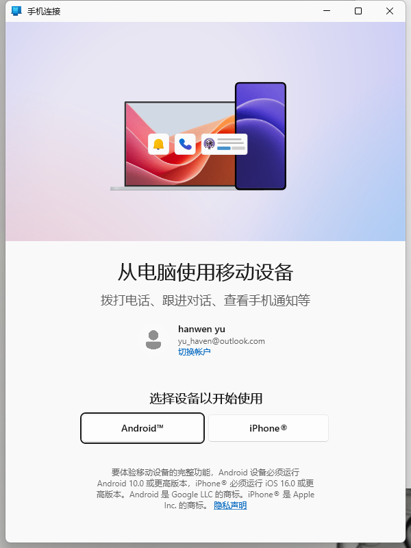
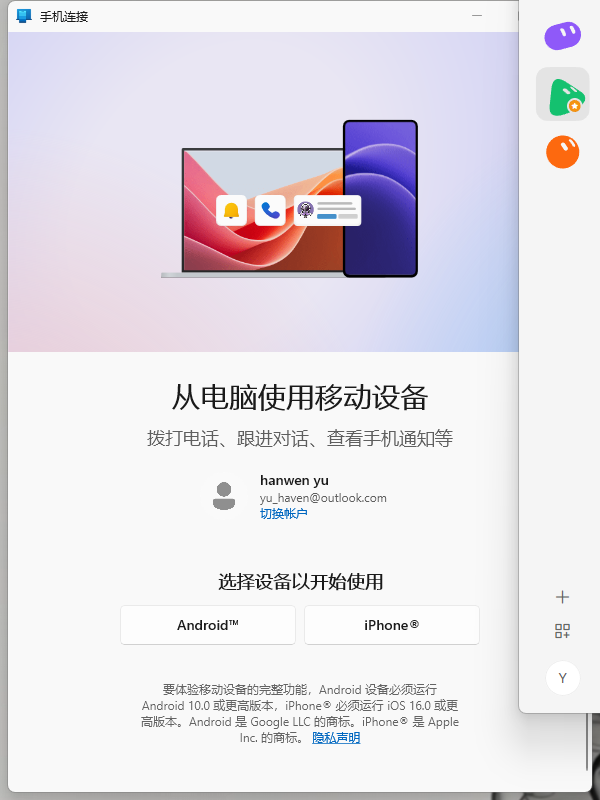
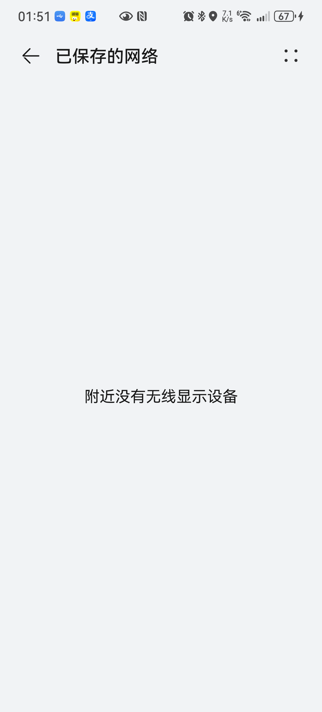
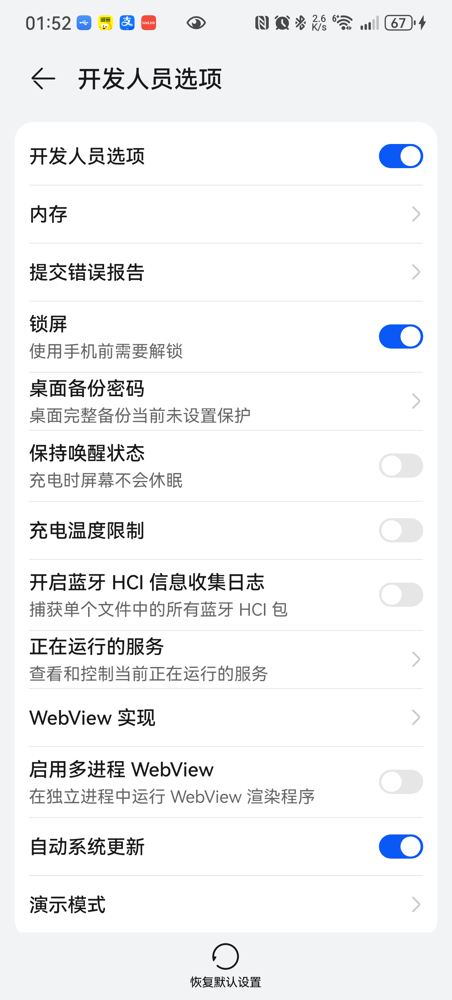
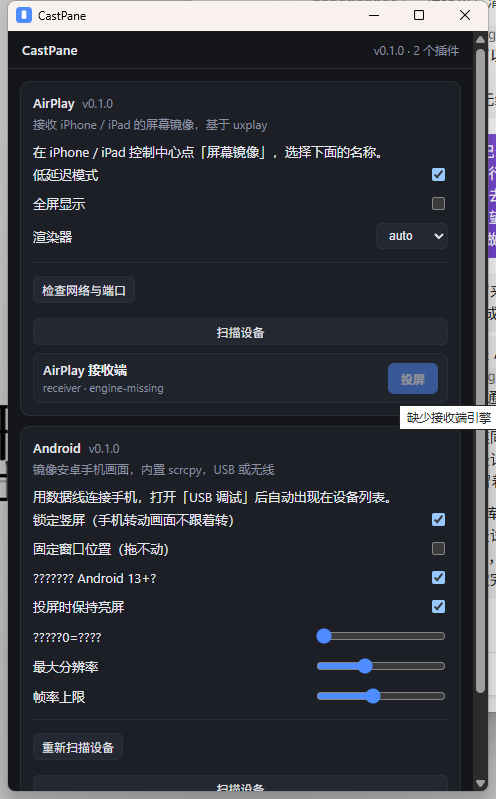

# 竞品拆解：同 Wi-Fi 无线投屏的信息层级（华为 / 鸿蒙路径）

- 日期：2026-11-16
- 目的：确定 CastPane 0.2 首屏、首次开通和投屏状态的信息层级。
- 关键事实：目标机 HUAWEI Mate 60（BRA-AL00）是 HarmonyOS 4.2.0 / Android 12，开发者选项中没有「无线调试」。因此竞品里 Android 原生「无线调试配对」只作为**不可用路径**记录，不作为设计目标。
- 用户不在场且已授权自行选定方案；需要拍板的取舍写在交付说明。

## 1. 拆解表

| 软件 | 截图 | 控件位置 / 层级 | 交互 | 对我们的结论 |
|---|---|---|---|---|
| **Windows 手机连接（Phone Link）** |  | 顶部大插画（约 40% 高）→ 产品标题 → 一句价值说明 → 账号 → 「选择设备以开始使用」→ 两个大按钮（Android / iPhone） | 首屏没有连接参数；先选生态，再进入下一步。主动作在视觉中心偏下，按钮整行宽 | 首屏需要「大留白 + 强主标题 + 一个主动作」。我们把插画缩小为 92px 的空态图标，把空间留给设备列表 |
| **Windows 手机连接（选 Android 后）** |  | 同一插画与标题；两个平台按钮变成选中态；下一步才出现 QR/账号引导 | 一次只问一个问题；不把调试参数放在首屏 | 首次开通也遵守「一次只做一件事」：首屏只给 3 条 USB 步骤，点一次「一键开启无线」；详细设置进「更多」 |
| **Android 系统「无线显示」** |  | 顶部返回 + 标题；内容区只有一个设备列表；空态一句话「附近没有无线显示设备」；无设置项 | 打开即扫描；点设备即连接；失败只给一句话 | 首屏设备列表占主体；空态不堆说明；状态行只保留一句可执行结论 |
| **Android 开发者选项（本机实拍，HarmonyOS 4.2）** |  | 顶部开关；下方是设置分组；**没有「无线调试」**（滚动到底也没有） | 用户只能打开 USB 调试；没有无线调试入口 | 必须写「USB 调试 / 仅充电模式下允许 ADB 调试」，不能引导用户找「无线调试」；首次必须用数据线 |
| **scrcpy（终端连接）** | 连接界面无 GUI；投屏窗口实拍见交付证据 | 连接发生在终端：`adb tcpip` / `adb connect` / `scrcpy`；投屏窗口只有画面与原生标题栏 | 用户需要自己敲 IP、端口；成功后窗口与终端分离 | 学它的「连接与画面分层」：调试/设置绝不进画面；把命令收进「一键开启无线」和进度层 |
| **CastPane 0.1（改造前基线）** |  | 两张插件卡；每张含说明、开关、滑块、扫描按钮、行内「投屏」按钮、日志；首屏可交互元素 12+；需要滚动 | 先找 Android 卡，再找「扫描设备」，再找行内「投屏」；没有无线入口 | 反面基线。删除首屏扫描、行内投屏、全部设置与日志；AirPlay 移入「更多」 |

## 2. 对照结论（决定 0.2 的设计）

1. **一个主按钮承载默认路径**：首屏不再有「扫描设备」和每行「投屏」。主按钮根据状态变为「检测手机 / 一键开启无线 / 开始投屏 / 停止投屏 / 重新连接 / 重新检测」。
2. **设备列表是首屏主体**：最多显示 3 行（无线、USB 首次开通、上次连接）；每行可选中，行内不再放第二个按钮。
3. **一行状态**：只写「现在怎样 + 用户下一步做什么」，例如「手机已用 USB 连接 · 一键开启无线」。完整原因和 adb 原始输出在「更多 → 诊断」。
4. **设置全部下沉**：「更多」抽屉里保留原有开关/滑块/日志/AirPlay；首屏 0 个调试控件。
5. **首次开通没有配对码**：华为 / 鸿蒙没有无线调试。流程是「3 条 USB 步骤 → 一键开启无线（tcpip 5555 + connect）→ 进度层 3 步 → 可拔线」。进度层只展示过程，不要求输入任何东西。
6. **视觉层级**：深色底 + 单一渐变强调色；设备名 15–16px/600；状态 11.5px；主按钮 46px 高、整行宽；留白优先于分隔线。
7. **不堆调试控件**：投屏窗口保持原生标题栏，画面内只有既有的半透明旋转按钮；连接/进度界面不覆盖画面。

## 3. 线框图

见 `docs/assets/wireless-wireframe.png`（源文件 `docs/design/wireless-wireframe.html`）。包含：

- 左：首次 USB 连接（设备行「首次开通」，主按钮「一键开启无线」，内联 3 条步骤）。
- 中：一键开启的进度层（读取 IP → 开启 5555 → 连接并启动；无需输入任何东西）。
- 右：已切到无线（设备行「无线 · 同一 Wi-Fi」，主按钮「开始投屏」）。

## 4. 参考来源

- scrcpy 官方仓库（无线连接与窗口分离）：<https://github.com/Genymobile/scrcpy>
- Microsoft 支持「在手机连接中设置和使用手机屏幕」：<https://support.microsoft.com/zh-cn/windows/apps/phonelink/setting-up-and-using-phone-screen-in-the-phone-link>
- Android 开发者「在硬件设备上运行应用 / 无线调试」：<https://developer.android.com/studio/run/device#wireless>（仅作对照；华为 / 鸿蒙无此入口）
- 本机实拍：Windows 手机连接 0.26092.119.0；HUAWEI BRA-AL00 / HarmonyOS 4.2.0 开发者选项；CastPane 0.1 基线。
