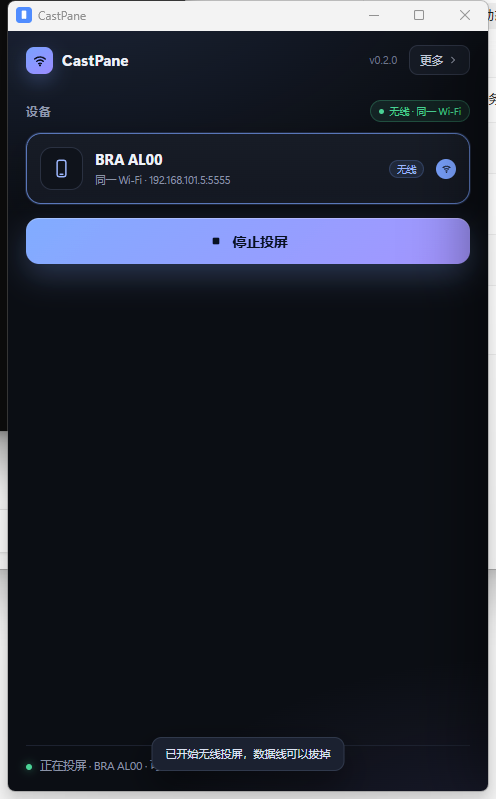
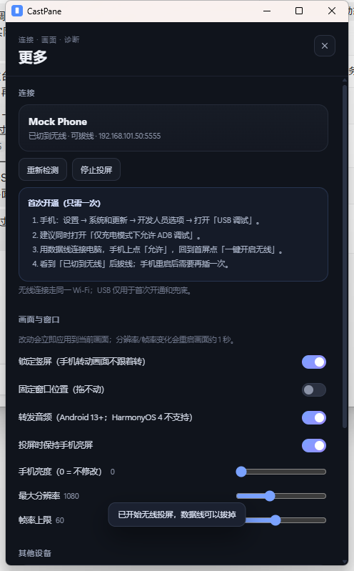
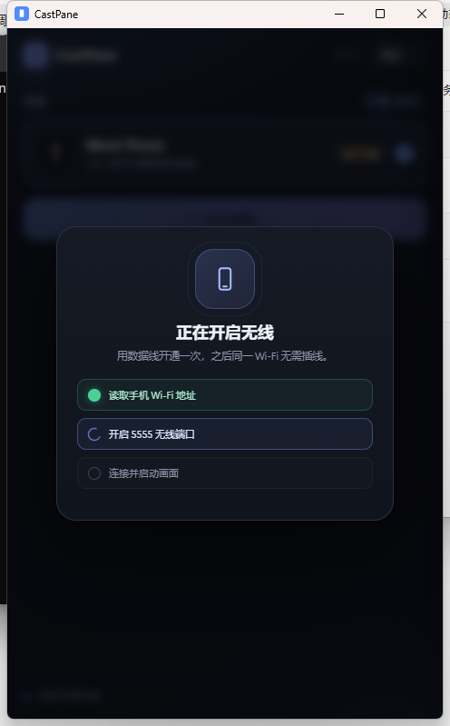
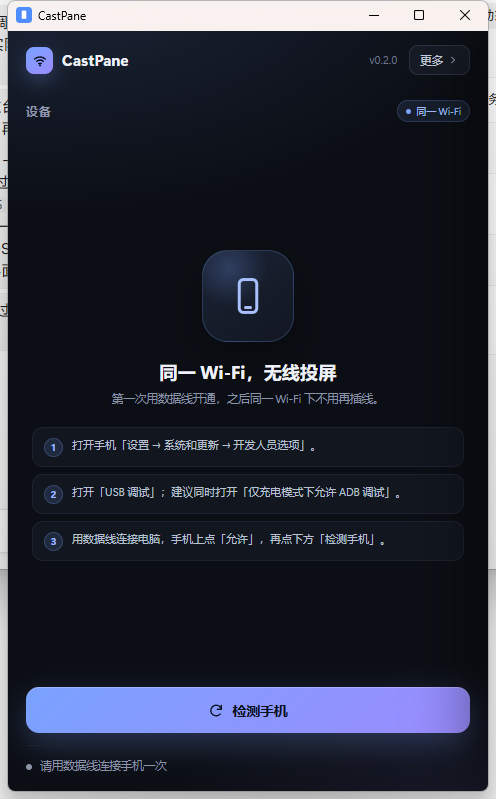

> 历史版本：本文件描述 v0.2.0。v0.3.0（iPad / AirPlay + 文件互传）见根目录 `iPad投屏与文件互传-交付说明.md`。

# CastPane 0.2.0 无线投屏交付说明

- 交付时间：2026-11-16 凌晨
- 目标机型：HUAWEI Mate 60（BRA-AL00）/ HarmonyOS 4.2.0 / EMUI 14.2.0 / Android 12（API 31）
- 发布包：`dist/CastPane-v0.2.0-win64.zip`（17.6 MB；SHA-256 见同目录 `.sha256` 文件）
- 上一版回滚包：`dist/CastPane-v0.1.0-win64.zip`（保留未删）

## 1. 一句话结论

**能做什么（已验证）**：同一 Wi-Fi 下的真机无线投屏已经跑通——`adb tcpip 5555` + `adb connect 192.168.101.5:5555`，scrcpy 用无线串口启动，窗口在 1.4 秒内出现；首屏已改成无线优先、USB 一次开通的 3 块布局。

**还不能宣称什么（已改，待真机验证）**：今晚测试中为了验证 USB 首次路径执行了 `adb usb`，手机回到 USB 模式后 Windows 没有重新枚举到 USB 设备，因此「在真机上点『一键开启无线』→ 拔线 → 画面出现」的完整 UI 链路没有在真机上走完。该链路由 L2 协议测试 + L3 mock adb/mock scrcpy 点击测试覆盖（3.97 秒到 streaming），但**不能替代真机证据**。

## 2. 今晚交付的用户体验

### 首次使用（华为 / 鸿蒙）

首屏只保留三块：**设备列表（含一个主按钮）**、**一行状态**、**一个「更多」入口**；可交互元素 2–3 个。

- 没设备时，设备区内联 3 条步骤：
  1. 设置 → 系统和更新 → 开发人员选项。
  2. 打开「USB 调试」；建议同时打开「仅充电模式下允许 ADB 调试」。
  3. 数据线连接电脑，手机点「允许」，回来点「检测手机」。
- 检测到 USB 后，设备行显示「首次开通」，主按钮变为「一键开启无线」。
- 点一次后，进度层逐步显示：
  1. 读取手机 Wi-Fi 地址
  2. 开启 5555 无线端口
  3. 连接并启动画面
- 成功后设备行变为「无线 · 同一 Wi-Fi」，状态行「正在投屏 · <手机名> · 可拔线」，数据线可以拔掉。
- 失败时进度层保留原因，并提供「重试 / 直接用 USB 投屏 / 关闭」。

### 二次使用

- 打开应用时自动尝试上次的 `IP:5555`，成功则设备行「已连接」，主按钮「开始投屏」。
- 手机重启 / 换 Wi-Fi / 换 IP 后自动重连会失败，状态行明确写「无线连接已失效；手机重启或切换 Wi-Fi 后需重新插线」。
- 「更多」里保留全部画面设置、AirPlay、诊断和日志；首屏 0 个调试控件。

### 关键文案

- 不再出现「请打开无线调试」「输入配对码」「扫码配对」。
- 华为路径固定为「设置 → 系统和更新 → 开发人员选项 → USB 调试」。
- 状态示例：
  - 「手机已用 USB 连接 · 一键开启无线」
  - 「已连接 BRA AL00 · 同一 Wi-Fi」
  - 「USB 调试未授权 · 请在手机上点『允许』」
  - 「手机与电脑不在同一 Wi-Fi」
  - 「BRA AL00 的无线连接已失效」
  - 「设备已掉线 · 请检查 Wi-Fi 后重连」

## 3. 明天早上如何试用（按这个顺序）

> 测试结束时手机被切回 USB 模式，Windows 当前没有枚举到它。**明早请先重插一次数据线**，并在手机上允许 USB 调试。

1. 确认手机与电脑连同一个 Wi-Fi（当前电脑 `192.168.101.6`，手机此前为 `192.168.101.5`）。
2. 手机：设置 → 系统和更新 → 开发人员选项 → 打开「USB 调试」；建议同时打开「仅充电模式下允许 ADB 调试」。
3. 数据线连接电脑；手机弹出「允许 USB 调试」时点「允许」。
4. 解压 `dist/CastPane-v0.2.0-win64.zip`，运行 `CastPane.exe`。
5. 首屏应出现「首次开通」设备行；点「一键开启无线」。
6. 进度层三步走完后，状态行应为「正在投屏 · … · 可拔线」；此时拔掉数据线，画面应继续。
7. 关掉投屏窗口，再关掉应用重新打开；设备应在 3 秒内变成「已连接」，点「开始投屏」即可。
8. 手机重启后再打开应用，应看到「无线连接已失效」；插一次线，点「一键开启无线」恢复。

如果第 5 步失败：
- 「USB 调试未授权」→ 手机上点允许，重新检测。
- 「手机与电脑不在同一 Wi-Fi」→ 让手机连同一个 Wi-Fi。
- 「USB 转无线失败」→ 端口 5555 可能被其他 adb 占用；关闭其他 adb 程序，或重插后再试。
- 仍失败 → 点「更多 → 诊断」把检查项和日志截图发我。

## 4. 验证证据

### 4.1 真机无线画面（已验证）

在手机被切回 USB 之前，使用仓库内 adb 完成：

```text
adb -s 37R0224308003011 tcpip 5555
restarting in TCP mode port: 5555

adb connect 192.168.101.5:5555
connected to 192.168.101.5:5555

adb devices -l
192.168.101.5:5555     device product:BRA-AL00 model:BRA_AL00 device:HWBRA
```

随后通过插件 `session.start` 使用 `192.168.101.5:5555` 启动 scrcpy，`e2e_probe.py measure` 在 **1.4 秒**内测到窗口：

```json
{"hwnd": 9375946, "x": 2016, "y": 160, "w": 504, "h": 1119,
 "ratio": 0.45, "caption": true, "minimize_box": true,
 "maximize_box": true, "topmost": false}
```

真机首屏与投屏状态截图：



> 说明：这张截图来自真机 `192.168.101.5:5555` 无线会话；画面窗口为真实的 scrcpy 进程。窗口结构另见 [cast-window.png](assets/evidence/cast-window.png)（该图是较早的 USB 会话，标题栏串口不同，但窗口/导航条结构相同）。

### 4.2 L2 协议测试（已通过）

```powershell
cargo test -p castpane-plugin-android
```

- 24 个单元测试通过（含：`wireless` 状态判定、同网段、记住端点、tcpip 候选、状态文案）。
- 6 个集成测试通过，覆盖：
  - USB → `tcpip` → `connect` → scrcpy 使用 `IP:5555` → `streaming`；
  - 二次启动自动重连记住的端点，无需点击；
  - 不同网段拒绝开启；
  - 无设备时给华为 USB 首次开通提示；
  - USB 未授权拒绝；
  - 原有的 mock 会话/窗口参数测试。
- 1 个 smoke 测试通过。
- `cargo test --workspace` 全绿（core / airplay / android 全部现有测试）。

### 4.3 L3 UI E2E（release 包，mock adb/mock scrcpy）

```powershell
powershell -ExecutionPolicy Bypass -File scripts\e2e_wireless.ps1 -Scenario mock-usb
powershell -ExecutionPolicy Bypass -File scripts\e2e_wireless.ps1 -Scenario mock-empty
powershell -ExecutionPolicy Bypass -File scripts\e2e_wireless.ps1 -Scenario mock-network
powershell -ExecutionPolicy Bypass -File scripts\e2e_wireless.ps1 -Scenario mock-reconnect
```

结果（真实 UIA 鼠标点击，不是直接调插件）：

| 场景 | 状态 | 耗时 | 截图 |
|---|---|---|---|
| mock-usb：USB 手机 → 一键开启 → streaming | PASS | **3.97 s** | [usb-first-home.png](assets/evidence/usb-first-home.png) / [usb-first-streaming.png](assets/evidence/usb-first-streaming.png) |
| mock-empty：无设备空态 | PASS | — | [empty-state.png](assets/evidence/empty-state.png) |
| mock-network：不同网段失败 | PASS | — | [network-error.png](assets/evidence/network-error.png) |
| mock-reconnect：二次打开自动重连 → 一键投屏 | PASS | 自动重连 ready；点击到 streaming **2.33 s** | [reconnect-home.png](assets/evidence/reconnect-home.png) / [reconnect-streaming.png](assets/evidence/reconnect-streaming.png) |

「更多」抽屉（设置/诊断/日志/AirPlay 都在这里）：



首次开通进度层实拍（debug 包，同一 UI）：



### 4.4 真机 UI E2E（未通过前置条件）

```powershell
powershell -ExecutionPolicy Bypass -File scripts\e2e_wireless.ps1 -Scenario real
```

输出：

```text
PRECONDITION FAILED: no Android device in "adb devices".
Connect the phone by USB, enable USB debugging, allow it, then rerun.
EXIT=2
```

原因：测试 USB 首次路径时执行了 `adb usb`，手机回到 USB 模式；Windows 之后没有重新枚举到 USB 设备（`Get-PnpDevice` 无 HUAWEI / ADB 设备），手机也不在 TCP 监听状态。**因此真机 UI 点击「一键开启无线」的闭环尚未验证，标记为「已改，待真机验证」。**

release 包在真实 adb、无设备时的首屏（不会假装已连接，直接给华为 USB 首次开通步骤）：



### 4.5 发布包校验

- `dist/CastPane/settings.json` 不存在（发布包不带测试配置）。
- zip 内 `settings.json` / `mock*` / `e2e*` / `.pdb` / `.log` 匹配数：0。
- Android 插件版本：0.2.0；应用版本：0.2.0（界面右上角显示 `v0.2.0`）。
- `CastPane-cli.exe --diagnose`：scrcpy/adb 检查通过；当前无设备时给出 USB 首次开通提示。
- 旧版 `dist/CastPane-v0.1.0-win64.zip` 保留，可直接回滚。
- 机器可读结果：[verification-results.json](assets/evidence/verification-results.json)。

## 5. 能做 / 不能做 / 已知问题

### 能做

- 同一 Wi-Fi 的华为 / 安卓手机无线投屏（USB 一次 `tcpip 5555` 后）。
- 首次开通：发现 USB、读取手机 Wi-Fi IP、同网段校验、`tcpip`、`connect`、启动画面，一条主按钮完成。
- 记住上次 `IP:5555`，下次启动自动尝试重连；失败时一键重试。
- 清楚区分：没开 USB 调试、USB 未授权、手机没连 Wi-Fi、不同网段、tcpip 失效、端口/连接失败、投屏中掉线。
- 「更多」里保留画面设置、AirPlay、诊断、日志；首屏无调试控件。

### 不能做 / 本轮没做

- **不做** Android 11+「无线调试 / `adb pair` / 配对码 / 二维码」：目标鸿蒙机型没有该入口。
- 不能替用户打开 USB 调试或自动允许授权；首次必须插线并点手机上的「允许」。
- 手机重启、切换 Wi-Fi、路由器换 IP 后，`tcpip` 会失效，必须再插一次线；应用只能提示，不能隔空恢复。
- 不同网段、公共 Wi-Fi、AP 隔离不做自动打洞。
- Android 12 不支持 scrcpy 音频转发（需 API 33+）；画面可用，声音仍在手机。
- AirPlay 仍待真机验证；本轮未改。
- `scripts/gate.ps1` 尚未实现；本版本没有声称门禁全绿。
- 真机 UI 首次开通链路待验证（见 4.4）。

### 已知问题

- 首次开通后如果 Windows 未重新枚举 USB（本次测试就遇到了），重插数据线/换 USB 口通常恢复；应用会显示空态，不会假装已连接。
- 自动重连只尝试记住的 `IP:5555`，不做局域网端口扫描；换 IP 后需要插线重新开通。
- 端口 5555 可能被其他 adb 程序占用；失败时只能提示，没有自动换端口。
- 投屏中掉线的状态路径已实现，但本轮手机失联后未能再跑真机掉线用例；L2 mock 覆盖了设备离线判定。
- 「更多」里的设置控件沿用旧面板；本轮没有逐项补 UI 自动化（仅保留原有实时生效逻辑）。
- 首次开通的进度层是「读取 IP → 开启端口 → 启动画面」的近似进度（后端一次调用），不是逐字节真实进度；失败时会停在对应步骤并给出原因。

## 6. 需要你拍板的点（不阻塞今晚）

1. **是否保留 5555 兜底**：`adb tcpip 5555` 会在局域网开放调试端口。个人家庭网络可接受；如果你更在意安全，可改成每次随机端口，但手机重启后的恢复步骤会更复杂。
2. **一键开启后是否自动投屏**：当前是「开启 + 连接 + 自动启动画面」，步骤最短；如果你希望先只开通、稍后自己点「开始投屏」，可以改成两段。
3. **设备显示名**：当前用 `adb devices -l` 的 model，显示 `BRA AL00`；鸿蒙没有暴露 marketing name，是否要硬编码映射成「HUAWEI Mate 60」。
4. **AirPlay 去留**：目前收进「更多 → 其他设备」；如果你不用 iPhone，可以下一轮直接移除，进一步减首屏负担。

## 7. 回滚与构建

- 回滚：解压 `dist/CastPane-v0.1.0-win64.zip`，覆盖当前目录；设置文件不在 zip 内，不会把 0.2 的状态带回去。
- 构建路径：只使用 `npm run tauri -- build`（由 `scripts/package.ps1` 调用），界面版本号 `v0.2.0` 已显示。
- 发布包未包含测试用的 mock adb/scrcpy 与 `settings.json`。

## 8. DoD 对照（诚实版）

- [x] 需求卡已写，成功标准是可观察量。
- [x] 目标机型能力已确认（实机开发者选项无「无线调试」）。
- [x] 竞品拆解表 + 线框图。
- [x] 首屏可交互元素 ≤ 5（实际 2–3）。
- [x] 核心不含无线业务逻辑（全部在 Android 插件；Tauri 仅透传 action 参数）。
- [x] L1/L2 测试通过；L3 mock UI 点击通过。
- [ ] L3 真机 UI 首次开通链路：**待验证**（4.4）。
- [ ] L3 真机二次自动重连 / 掉线：**待验证**（手机当前不可达）。
- [x] 发布走 `npm run tauri -- build`；版本号正确。
- [x] 发布包默认配置已校验（无 settings.json、无测试产物）。
- [x] 文档与实现同批更新。
- [x] 回滚包保留。
- [ ] `scripts/gate.ps1`：未实现，未声称通过。

**结论：无线投屏的协议/引擎/真机画面已验证；release 包与 UI 首次开通用 mock 验证；真机 UI 首次开通与重启恢复明天按第 3 节复验。**
